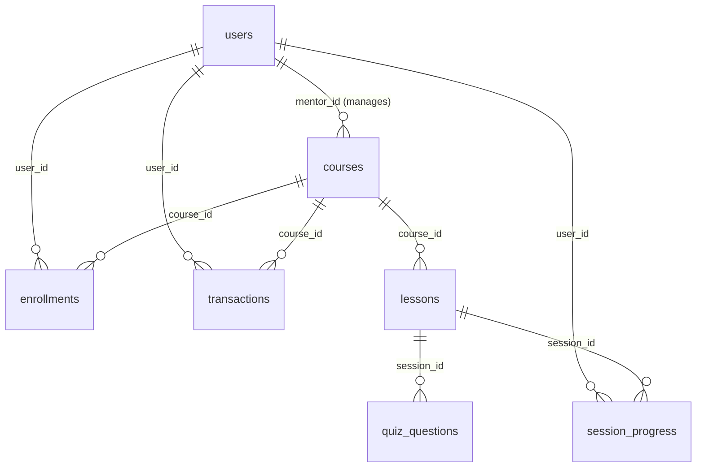

# Design Document — MUSLIM UPSKILL ACADEMY (UPSKILL by MATLA)

Dokumen ini merangkum arsitektur sistem, desain basis data, alur fitur utama, serta sistem desain antarmuka (UI/UX) dari platform **MUSLIM UPSKILL ACADEMY (UPSKILL by MATLA)** sebagai acuan pengembangan fitur-fitur berikutnya (termasuk Trial Quiz tanpa login, Leaderboard LMS peserta, dan monetisasi kelas berbayar).

---

## 1. Ringkasan Produk & Tujuan

**MUSLIM UPSKILL ACADEMY** adalah platform *Learning Management System* (LMS) dan evaluasi berbasis *Computer-Based Test* (CBT) yang dirancang untuk:
- Menyediakan katalog kelas pelatihan terstruktur (video YouTube & dokumen/PDF).
- Memastikan peserta menyelesaikan materi secara tuntas sebelum membuka evaluasi kuis.
- Menyelenggarakan ujian CBT (Pilihan Ganda & Essay) dengan timer, proteksi anti-curang (*anti-cheat*), koreksi otomatis/manual, pembahasan jawaban, serta pemeringkatan (*leaderboard*).
- Mendukung model peserta individu (**B2C**), institusi (**B2B**), mentor, serta pengelolaan terpusat oleh **Super Admin**.
- Disiapkan untuk ekspansi bertahap menuju kelas berbayar (tabel `transactions` dan kolom `courses.price` sudah tersedia di skema).

---

## 2. Arsitektur Teknis & Stack

| Lapisan | Teknologi |
| :--- | :--- |
| **Backend Framework** | CodeIgniter 4 (`codeigniter4/framework` ^4.7) |
| **Bahasa Runtime** | PHP ^8.2 |
| **Database** | MySQL 5.7+ / MariaDB 10.3+ (Engine: `InnoDB`, Charset: `utf8mb4_unicode_ci`) |
| **Frontend Styling** | Tailwind CSS (CDN) + Custom Brand Config |
| **Tipografi** | Google Fonts: `Inter` (utama) & `JetBrains Mono` (timer & angka CBT) |
| **Library UI Frontend** | Swiper.js v11 (slider katalog kelas), SweetAlert2 v11 (toast, konfirmasi, peringatan CBT) |
| **Integrasi Media** | YouTube IFrame Player API, Google Drive PDF `/preview` embed |
| **Target Deployment** | Shared Hosting (Apache `.htaccess`, struktur `public/`) |

### Struktur Direktori Utama (CI4)

```text
Upskill/
├── app/
│   ├── Config/
│   │   ├── Routes.php              # Definisi seluruh rute publik, peserta, CBT, dan admin
│   │   └── Filters.php             # Global CSRF, AuthGuard ('auth'), RoleGuard ('role')
│   ├── Controllers/
│   │   ├── Home.php                # Landing page & katalog kelas published
│   │   ├── Auth.php                # Login, Register (default peserta_b2c), Logout
│   │   ├── Course.php              # Redirect katalog, auto-enroll & akses kelas
│   │   ├── Dashboard.php           # Dasbor peserta, detail kelas, ruang belajar, hasil kuis & leaderboard
│   │   ├── Quiz.php                # Mesin ujian CBT (jadwal, timer, submit, auto-grade PG)
│   │   └── Admin/
│   │       ├── Dashboard.php       # Statistik real-time & 5 submission terbaru
│   │       ├── Course.php          # CRUD kelas & upload banner (max 2MB)
│   │       ├── Lesson.php          # CRUD sesi kurikulum per kelas
│   │       ├── Quiz.php            # CRUD soal PG/Essay, jadwal/durasi CBT, reset attempt
│   │       ├── Report.php          # Laporan nilai, leaderboard, koreksi manual essay
│   │       └── User.php            # CRUD pengguna + proteksi Super Admin ID 1
│   ├── Database/Migrations/        # Migrasi tambahan untuk kolom statistik & grading CBT
│   ├── Filters/
│   │   ├── AuthGuard.php           # Cek session `isLoggedIn`
│   │   └── RoleGuard.php           # Cek session `role` terhadap parameter rute
│   ├── Models/                     # UserModel, CourseModel, LessonModel, QuizQuestionModel, EnrollmentModel, SessionProgressModel
│   └── Views/
│       ├── layout/                 # main.php (publik), auth.php (login/register)
│       ├── home/                   # index.php (landing page)
│       ├── auth/                   # login.php, register.php
│       ├── dashboard/              # index.php, account.php, course.php, learn.php, quiz_result.php
│       ├── quiz/                   # cbt.php, cbt_notice.php, cbt_result.php
│       └── admin/                  # layout.php + modul dashboard, courses, lessons, quiz, reports, users
├── public/
│   ├── assets/images/              # Logo brand
│   └── uploads/courses/            # Banner kelas
└── schema.sql                      # Skema basis data awal (7 tabel inti)
```

> **Catatan Struktur:** Terdapat beberapa direktori lama di root (`controllers/`, `models/`, `views/`, `config/`, `assets/`). Seluruh aplikasi aktif berjalan di dalam struktur CodeIgniter 4 (`app/` dan `public/`).

---

## 3. Desain Basis Data (ERD & Skema)

### Relasi Entitas



### Ringkasan Tabel

1. **`users`**
   - Kolom: `id`, `full_name`, `email` (unique), `password_hash`, `role` (`super_admin`, `mentor`, `peserta_b2c`, `peserta_b2b`), `instansi_name`, `created_at`.
   - Password di-hash menggunakan `password_hash(..., PASSWORD_DEFAULT)` / `PASSWORD_BCRYPT`.

2. **`courses`**
   - Kolom: `id`, `mentor_id` (FK -> `users.id`), `title`, `slug` (unique, auto-generated), `description`, `price` (`DECIMAL(10,2)`, default `0.00` untuk MVP gratis), `banner_image`, `status` (`draft`, `published`), `created_at`.

3. **`lessons`** *(Sesi Pembelajaran & Konfigurasi CBT)*
   - Kolom: `id`, `course_id` (FK -> `courses.id` ON DELETE CASCADE), `chapter_title`, `content_type` (`video`, `text_pdf`, `text`), `content_url_or_text`, `quiz_url`, `order_index`, `quiz_start_time`, `quiz_end_time`, `quiz_duration_minutes`, `created_at`.

4. **`quiz_questions`** *(Butir Soal per Sesi)*
   - Kolom: `id`, `session_id` (FK -> `lessons.id` ON DELETE CASCADE), `question_text`, `question_type` (`pg`, `essay`), `option_a..d`, `correct_answer` (`a`, `b`, `c`, `d` — nullable untuk essay), `created_at`.

5. **`enrollments`** *(Kepesertaan & Progres Kelas)*
   - Kolom: `id`, `user_id`, `course_id`, `progress_percentage` (0–100), `status` (`active`, `completed`), `enrolled_at`.
   - Unique key: `(user_id, course_id)`.

6. **`session_progress`** *(Progres Materi, Hasil CBT, & Koreksi)*
   - Skema dasar: `id`, `user_id`, `session_id`, `is_completed`, `quiz_completed`, `quiz_score` (`DECIMAL(5,2)`), `quiz_completed_at`, `completed_at`, `created_at`.
   - Kolom tambahan dari migrasi (`app/Database/Migrations/`):
     - `correct_count` (`INT`) — jumlah jawaban benar.
     - `total_questions` (`INT`) — total soal saat pengerjaan.
     - `duration_seconds` (`INT`) — durasi aktual pengerjaan kuis dalam detik.
     - `answers_json` (`LONGTEXT`) — JSON jawaban peserta (`{ question_id: answer }`).
     - `grading_status` (`VARCHAR(30)`, default `'graded'`) — `'graded'` atau `'pending_review'` (jika ada soal essay).
     - `admin_feedback_json` (`LONGTEXT`) — JSON status & catatan koreksi manual essay oleh instruktur per `question_id`.
   - Unique key: `(user_id, session_id)` — sekaligus menegakkan aturan 1x pengerjaan per sesi sebelum di-reset admin.

7. **`transactions`** *(Fondasi Monetisasi — Siap Pakai)*
   - Kolom: `id` (`VARCHAR(50)` PK), `user_id`, `course_id`, `amount`, `status` (`pending`, `success`, `failed`), `payment_method`, `created_at`.

---

## 4. Peran Pengguna, Autentikasi & Keamanan

### Hak Akses (Role-Based Access Control)

| Role | Rute Tujuan Setelah Login | Hak Akses Utama |
| :--- | :--- | :--- |
| `super_admin` | `/admin/dashboard` | Akses penuh panel admin (`/admin/*`): ringkasan, kelola pengguna, katalog kelas, kurikulum sesi, bank soal CBT, laporan nilai & koreksi essay. |
| `mentor` | `/dashboard` | Saat ini diarahkan ke dasbor reguler; relasi `courses.mentor_id` sudah disiapkan untuk manajemen kelas oleh mentor. |
| `peserta_b2c` | `/dashboard` | Role default registrasi mandiri. Akses katalog, enroll kelas, ruang belajar, ujian CBT, hasil evaluasi & leaderboard sesi. |
| `peserta_b2b` | `/dashboard` | Sama seperti `peserta_b2c` dengan label instansi (`instansi_name`). |

### Lapisan Keamanan
- **Session Guard:** `AuthGuard` (`auth`) memvalidasi `session('isLoggedIn')`, `RoleGuard` (`role:super_admin`) memvalidasi role.
- **CSRF Protection:** Aktif secara global di `Config\Filters::$globals['before']`, dengan pengecualian khusus pada endpoint AJAX `dashboard/mark_completed/*`.
- **Proteksi Akun Admin Utama:** `Admin\User` mencegah demosi role atau penghapusan pada User ID `1` serta mencegah admin menghapus akunnya sendiri.
- **Catatan Keamanan Rute CBT:** Rute `GET sessions/(:num)/cbt` dan `POST sessions/(:num)/cbt/submit` saat ini belum memasang filter `auth` secara eksplisit di `Routes.php` (meski `dashboard/quiz/(:num)` sudah terproteksi `auth`). Perlu diperhatikan saat merancang pemisahan antara **CBT Terautentikasi** dan **Trial Quiz Publik**.

---

## 5. Arsitektur Alur Fitur Utama

### 5.1. Alur Belajar & Pembukaan Kunci Kuis
1. Peserta melihat katalog di `/` atau `/dashboard`, lalu masuk ke silabus kelas (`/dashboard/course/{courseId}`) — sistem otomatis melakukan *auto-enroll* untuk MVP kelas gratis.
2. Peserta membuka sesi materi di `/dashboard/learn/{sessionId}`:
   - **Tipe `video`:** Embed YouTube dengan YouTube IFrame API (wajib tonton tuntas).
   - **Tipe `text_pdf`:** Embed dokumen/PDF (termasuk konversi otomatis link Google Drive `/view` -> `/preview`) dengan timer baca aktif 3 menit yang dijeda otomatis saat pindah tab (*Page Visibility API*).
   - Tersedia pula jalur `/dashboard/access_material/{sessionId}` untuk materi tautan eksternal.
3. Setelah tuntas, frontend memanggil AJAX `/dashboard/mark_completed/{sessionId}` untuk menyimpan `is_completed = 1`, memperbarui `enrollments.progress_percentage`, dan membuka tombol kuis.

### 5.2. Alur Ujian CBT, Penilaian & Leaderboard
1. **Validasi Akses (`Quiz::cbt`):**
   - Cek jendela waktu buka/tutup (`quiz_start_time` & `quiz_end_time`) berbasis zona waktu `Asia/Jakarta` -> tampilkan `quiz/cbt_notice.php` jika belum buka/sudah tutup.
   - Cek proteksi 1x pengerjaan (`isQuizCompleted`).
   - Simpan timestamp mulai ujian di session (`quiz_start_timestamp_{sessionId}`) untuk mengukur durasi pengerjaan.
2. **Antarmuka Ujian (`quiz/cbt.php`):**
   - Tampilan 1 soal per layar (*single-question view*) dengan panel navigasi nomor soal di kiri.
   - Countdown timer dengan *auto-submit* saat waktu habis.
   - **Anti-Cheat:** Blokir seleksi teks, klik kanan, copy/cut/paste, serta deteksi pindah tab via `visibilitychange` (maksimal 3 peringatan; pelanggaran ke-4 memicu diskualifikasi & *auto-submit*).
3. **Penilaian (`Quiz::submitCbt` & `Admin\Report::grade_submission`):**
   - **Full PG:** Skor dihitung otomatis `(correctPg / totalPg) * 100`, `grading_status = 'graded'`.
   - **Campuran PG + Essay:** Skor PG dicatat sebagai poin sementara proporsional terhadap total soal, `grading_status = 'pending_review'`. Admin mengoreksi essay via modal di `/admin/reports`, memberi nilai akhir + feedback per soal -> status berubah menjadi `'graded'`.
4. **Aturan Pemeringkatan (Leaderboard):**
   Digunakan secara konsisten di `Admin\Report::index` dan `Dashboard::quiz_result`:
   1. `grading_status = 'graded'` selalu di atas `'pending_review'`
   2. `quiz_score` tertinggi (`DESC`)
   3. `duration_seconds` tercepat (`ASC`)
   4. `completed_at` paling awal (`ASC`)
5. **Reset Attempt (`Admin\Quiz`):**
   Admin dapat mereset riwayat kuis per sesi secara manual (`/admin/sessions/{id}/quiz/reset`), atau otomatis ter-reset ketika seluruh soal pada sesi dihapus hingga 0. Status penyelesaian materi (`is_completed`) tetap dipertahankan.

---

## 6. Sistem Desain Visual (UI/UX Design System)

### 6.1. Palet Warna Brand (Canonical Tokens)

| Token Tailwind | Hex | Penggunaan Utama |
| :--- | :--- | :--- |
| `upskill-darkblue` | `#1C21AC` | Judul utama (`h1–h4`), teks penekanan, angka KPI, tombol outline |
| `upskill-blue` | `#0101FF` | Link navigasi utama, aksen ikon/badge tipe soal PG |
| `upskill-pink` | `#FA1886` | CTA utama (*Daftar Sekarang*, *Kumpulkan*), state aktif menu, aksen highlight, konfirmasi SweetAlert2 |
| `upskill-magenta` | `#B103C5` | Hover state dari tombol `upskill-pink` |
| Neutral Light (`slate-50`, `white`, `slate-200`) | `#F8FAFC` / `#FFFFFF` / `#E2E8F0` | Canvas halaman, kartu, border halus |
| Neutral Dark (`slate-900`, `slate-800`) | `#0F172A` / `#1E293B` | Sidebar Super Admin, tombol soal terjawab di CBT |
| Semantic Status | `emerald-*` / `amber-*` / `rose-*` / `blue-*` | Sukses & tuntas (`emerald`), pending review & peringatan (`amber`), error/logout/timer (`rose`), info (`blue`) |

> **Catatan Konsistensi Token:** Pada `app/Views/dashboard/learn.php`, konfigurasi inline Tailwind saat ini menggunakan font `Plus Jakarta Sans` dan kode warna sedikit berbeda (`#0A1128`, `#1C21AC`, `#FF385C`). Untuk pengembangan fitur baru (termasuk Trial Quiz & halaman LMS baru), gunakan **palet kanonis di atas + font `Inter`** agar identitas visual seragam di seluruh aplikasi.

### 6.2. Tipografi
- **Font Utama:** `Inter` (`300`, `400`, `500`, `600`, `700`, `800`), anti-aliased.
- **Font Monospace:** `JetBrains Mono` (`600`, `700`, `800`) khusus angka timer countdown dan durasi pengerjaan CBT.
- **Skala Tipografi:**
  - Hero Headline: `text-3xl sm:text-5xl font-extrabold tracking-tight`
  - Section Title: `text-2xl sm:text-3xl font-extrabold text-upskill-darkblue`
  - Overline / Eyebrow: `text-xs font-bold uppercase tracking-widest text-upskill-pink`
  - Card Title: `text-base` – `text-xl font-bold`
  - Body Copy: `text-sm` – `text-base text-slate-600 leading-relaxed`
  - Micro / Badge: `text-[10px]` – `text-xs font-semibold`

### 6.3. Pola Layout (Page Shells)

| Area | Shell Layout | Karakteristik Visual |
| :--- | :--- | :--- |
| **Publik / Landing** (`layout/main.php`) | Sticky top header (`h-20 sm:h-24`), container `max-w-6xl`, footer 4 kolom | Bersih, dominan putih, aksen pink/darkblue. Katalog kelas memakai **macOS window-style card** di atas layer *ambient blurred glow* dengan Swiper.js. |
| **Autentikasi** (`layout/auth.php`) | Header minimal dengan tombol kembali ke beranda, konten terpusat di `bg-slate-50/50`, tanpa footer | Fokus tinggi, dilengkapi toggle visibilitas password. |
| **Dasbor Peserta** (`dashboard/*.php`) | Sidebar kiri terang (`w-64`, `bg-white`, `hidden md:flex`) + area konten `bg-slate-50` + sticky top header (`h-16`) | Menu aktif menggunakan `bg-pink-50 text-upskill-pink`. KPI memakai grid 3 kolom kartu `rounded-xl border-slate-200`. |
| **Ruang Belajar** (`dashboard/learn.php`) | Fokus tanpa sidebar (`max-w-5xl`), sticky header dengan indikator urutan sesi & avatar inisial | Banner dinamis peringatan *tab-switch* & banner *quiz unlocked*. |
| **Ujian CBT** (`quiz/cbt.php`) | Distraction-free Dicoding-style: header tipis + countdown timer, sidebar kiri nomor soal (`grid-cols-5`, `w-72`), kanan 1 soal aktif (`max-w-4xl`) | Warna netral (`white` + `slate-800`) untuk kenyamanan membaca; tombol submit akhir berwarna `upskill-pink`. |
| **Hasil & Leaderboard** (`dashboard/quiz_result.php`) | Sticky top bar, 3 kartu ringkasan capaian, grid 2 kolom (`lg:col-span-2` pembahasan + `lg:col-span-1` leaderboard) | Membedakan jelas status `Nilai Akhir` vs `Poin Sementara (Pending Review)`. |
| **Super Admin** (`admin/layout.php`) | Sidebar gelap (`w-64 bg-slate-900`) + area konten terang (`bg-slate-50 max-w-7xl`) | Global SweetAlert2 toast untuk flashdata (`success`/`error`) dan modal konfirmasi otomatis untuk class `.btn-delete`. |

### 6.4. Komponen & Pola Interaksi
- **Radius Sudut:** Kartu konten `rounded-xl` / `rounded-2xl`, kartu hero slider `rounded-3xl`, tombol utama `rounded-lg` / `rounded-xl` / `rounded-full` (CTA outline), badge `rounded-full` atau `rounded`.
- **Elevasi:** Minimalist *flat-bordered* (`border border-slate-200 shadow-xs` / `shadow-2xs`), hanya memakai `shadow-xl` pada kartu slider macOS.
- **Notifikasi:** Flash alert inline di sisi peserta (`emerald-50`, `rose-50`, `blue-50`, `amber-50`) dan Toast SweetAlert2 di sisi Admin.

---

## 7. Peta Rute Saat Ini (Route Summary)

| Kelompok | Rute Utama | Proteksi |
| :--- | :--- | :--- |
| **Publik** | `GET /`, `GET /courses`, `GET /courses/(:segment)` | Publik |
| **Autentikasi** | `GET/POST /login`, `GET/POST /register`, `GET /logout` | Publik |
| **Enroll & Dasbor Peserta** | `GET/POST /courses/(:num)/enroll`, `GET /dashboard`, `GET /dashboard/account`, `POST /dashboard/account/update`, `GET /dashboard/course/(:num)`, `GET /dashboard/learn/(:num)`, `GET /dashboard/access_material/(:num)`, `GET /dashboard/quiz/(:num)`, `GET /dashboard/quiz-result/(:num)`, `GET/POST /dashboard/mark_completed/(:num)`, `GET/POST /dashboard/session/(:num)/complete` | `auth` |
| **Ujian CBT** | `GET /sessions/(:num)/cbt`, `POST /sessions/(:num)/cbt/submit` | Controller check (perlu diperketat saat pemisahan CBT vs Trial) |
| **Super Admin** | `/admin/dashboard`, `/admin/courses/*`, `/admin/courses/(:num)/lessons*`, `/admin/sessions/(:num)/*`, `/admin/quiz/*`, `/admin/reports*`, `/admin/users*` | `auth`, `role:super_admin` |

---

## 8. Titik Ekstensi untuk Pengembangan Berikutnya

Berdasarkan arsitektur yang sudah ada, fitur-fitur baru yang direncanakan dapat terintegrasi rapi melalui titik ekstensi berikut:
1. **Trial Quiz Tanpa Login (Lead Magnet Funnel):**
   - Menambahkan menu publik `Quiz` di navbar `layout/main.php` dan penanda quiz publik/trial (misal flag `is_trial` pada `lessons` atau tabel tersendiri untuk bank quiz publik + kolom pembahasan/dalil per soal).
   - Mode pengerjaan ringan tanpa login (5 soal, tanpa anti-cheat ketat) -> halaman hasil dengan skor + teaser pembahasan + tombol Share WhatsApp + CTA Daftar/Login untuk membuka pembahasan penuh, quiz lainnya, serta menyimpan skor trial ke akun.
2. **Menu Nilai & Peringkat Global di Dasbor Peserta:**
   - Saat ini leaderboard per sesi sudah ada di `/dashboard/quiz-result/{sessionId}`.
   - Dapat diperluas menjadi menu khusus **"Nilai & Peringkat"** di sidebar dasbor peserta (`/dashboard/scores` atau `/dashboard/leaderboard`) yang menampilkan rekap seluruh kuis yang sudah dikerjakan, daftar seluruh peserta, dan peringkat *real-time* secara langsung dari dasbor.
3. **Kelas Berbayar (Monetisasi):**
   - Memanfaatkan kolom `courses.price` dan tabel `transactions` yang sudah tersedia pada `schema.sql` untuk menggantikan alur *auto-enroll* gratis khusus pada kelas dengan `price > 0`.

